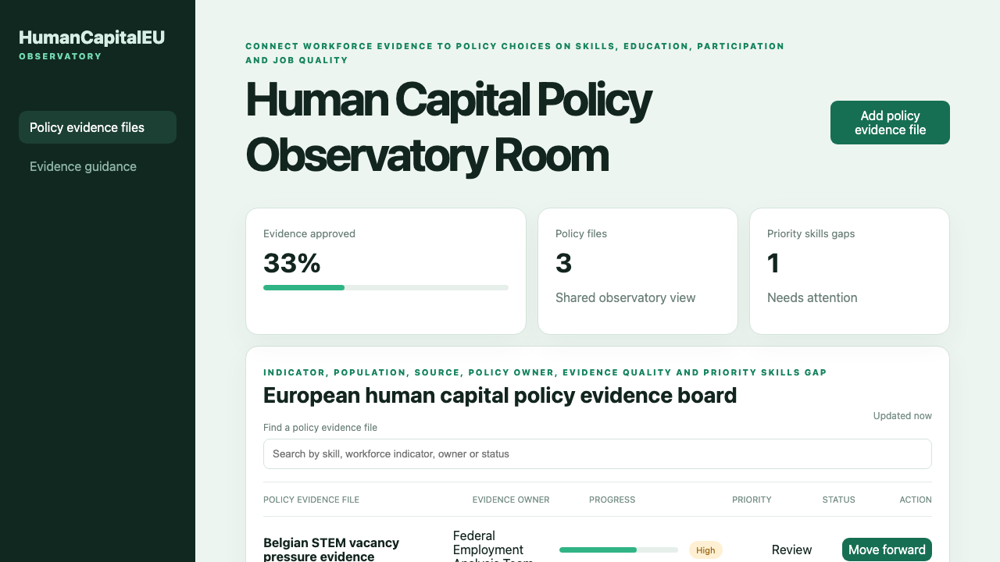

# Human Capital Policy Observatory Room

Turn workforce, education and skills evidence into a shared, reviewable policy portfolio.

## Live demo

Run the frontend and backend locally with the installation steps below, then open `http://localhost:5173`.

## Screenshots

## Main features

- Search and sort evidence files by indicator, owner, status or priority.
- Create policy evidence records and advance them through a real Java API.
- Compare approved evidence, open files and priority skills gaps.
- Navigate between the observatory room and evidence guidance.

## Technology used

Vue, TypeScript, Pinia, Vue Router, Vite, Vitest, Spring Boot, Jakarta Validation, JUnit and Maven.

## Installation instructions

Use Node.js 20+, Java 21 and Maven 3.9+. Run `npm install`, then start the API with `cd backend && mvn spring-boot:run`. In another terminal run `npm run dev`.

## Commercial licensing/contact

Commercial licensing and implementation enquiries: `100402995+Amitesh2022@users.noreply.github.com`.

## Business problem and users

Policy analysts, employment services, education authorities and consultancies need comparable evidence on skills, participation and job quality before recommending investment.

## Key workflows

Search workforce evidence, create a new policy file, review ownership and priority, advance its status and read the evidence guidance page.

## Vue framework highlights

Composition API, Pinia computed state, Vue Router pages and reactive filters keep the interface concise and testable.

## Java backend highlights

Spring Boot exposes validated list, search, create and update endpoints, structured errors, a health endpoint, service/domain separation and JUnit tests.

## Architecture and state flow

Pinia loads `/api/items`; actions send writes to Spring Boot; returned records update the reactive store and every computed metric.

## Accessibility and responsive behaviour

Labelled search, clear headings, keyboard-friendly controls, live error text and responsive tables support assistive technology and smaller screens.

## Verification commands

Run `npm test`, `npm run lint`, `npm run build`, `cd backend && mvn test` and `mvn package`.

## Structure

`src/` contains Vue views and state, `backend/` contains the Java service, and `docs/` contains reviewed product media.

## Tradeoffs

In-memory storage simplifies local evaluation; production use would add durable evidence sources, versioning, identity and jurisdiction-aware access.

## Roadmap

Add indicator provenance, regional comparisons, policy-impact targets, multilingual summaries and exportable evidence packs.
